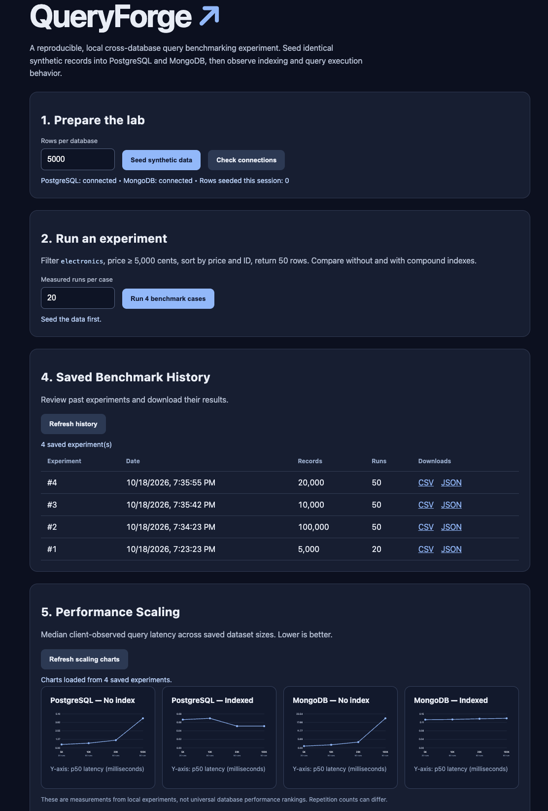

# QueryForge

**Cross-Database Performance Benchmarking & Query Analysis Platform**

QueryForge is a containerized performance engineering project that benchmarks PostgreSQL and MongoDB using reproducible synthetic workloads.

It helps developers explore how database indexing, dataset size, and query execution plans affect performance.

Built with **Python, FastAPI, PostgreSQL, MongoDB, Docker, SQLite, JavaScript, and pytest**.

## Features

- Benchmark PostgreSQL 16 and MongoDB 7
- Generate deterministic synthetic datasets of 1,000–100,000 records
- Compare indexed and unindexed queries
- Measure p50, p95, mean, minimum, and maximum query latency
- Measure sequential queries per second
- Inspect PostgreSQL EXPLAIN ANALYZE and MongoDB explain plans
- Save benchmark experiments in persistent SQLite storage
- Export experiment results as CSV or JSON
- Visualize latency scaling across different dataset sizes
- Run automated tests locally and through GitHub Actions

## Dashboard

The dashboard lets users generate synthetic data, run benchmark experiments, review execution plans, explore saved history, and compare performance across dataset sizes.

## Architecture

    Browser Dashboard
           |
           v
      FastAPI Backend
           |
      Benchmark Engine
       /          \
      v            v
    PostgreSQL    MongoDB
       \          /
        v        v
     Benchmark Results
           |
           v
     SQLite History
           |
           v
    CSV / JSON Exports
    Scaling Visualizations

## Quick Start

### Requirements

- Docker Desktop
- Docker Compose

### Run locally

Clone the repository:

    git clone https://github.com/shahariarsahil42/queryforge.git
    cd queryforge

Start the services:

    docker compose up --build -d

Open the dashboard:

    http://localhost:8000

API documentation:

    http://localhost:8000/docs

### Run tests

    docker compose exec api python -m pytest -v

The current local test suite contains 14 passing tests.

### Stop services

    docker compose down

Docker named volumes preserve database data and saved experiment history across normal container restarts.

Do not use `docker compose down -v` unless you intentionally want to delete the local database volumes.

## Benchmark Workload

QueryForge generates equivalent synthetic product records in PostgreSQL and MongoDB using a deterministic random seed.

The primary query:

1. Filters products in the `electronics` category
2. Filters prices greater than or equal to 5,000 cents
3. Sorts by price and product ID
4. Returns the first 50 matching records

Each database is benchmarked in two configurations:

- Without a workload-specific secondary index
- With a compound index supporting filtering and ordering

Connections remain open during repeated measurements to reduce connection-setup effects.

## Experimental Results

Example measurements from a local experiment using 100,000 synthetic records per database and 50 measured repetitions per case:

| Database | No Index p50 | Indexed p50 | Observed Speedup |
|---|---:|---:|---:|
| PostgreSQL | 4.431 ms | 0.050 ms | 88.6x |
| MongoDB | 20.471 ms | 0.132 ms | 155.1x |

The measurements are client-observed query and result-fetching times.

These results are specific to the tested hardware, workload, dataset, and local environment. They should not be interpreted as a general ranking of PostgreSQL versus MongoDB.

## Query Plan Findings

### PostgreSQL

The unindexed query used a sequential scan and sorting operation.

With the compound index, PostgreSQL used an index-only scan and avoided the separate sorting step.

### MongoDB

The unindexed query used `COLLSCAN` and `SORT`.

With indexing, MongoDB used `IXSCAN`, `FETCH`, and `LIMIT`.

In one 20,000-record experiment, the indexed MongoDB query examined 50 documents compared with 20,000 documents without the index.

## Benchmark History and Export

Every completed experiment is saved with its dataset size, repetition count, timestamp, results, and query-plan observations.

Endpoints:

| Endpoint | Purpose |
|---|---|
| GET /health | API health check |
| GET /api/status | Database connection status |
| POST /api/setup | Generate and load synthetic data |
| POST /api/benchmark | Run benchmark experiments |
| GET /api/history | List saved experiments |
| GET /api/history/{id} | Retrieve an experiment |
| GET /api/history/{id}/export?format=csv | Download CSV |
| GET /api/history/{id}/export?format=json | Download JSON |

## Testing and CI

QueryForge uses pytest to validate API behavior, benchmark calculations, dataset generation, experiment history, and exports.

GitHub Actions runs the automated test suite on repository changes.

## Engineering Limitations

- The benchmark currently focuses on one query workload.
- Measurements are sequential rather than concurrent load tests.
- Database caching, OS scheduling, and run order can affect results.
- Independent trials and randomized experiment ordering would improve statistical reliability.
- This application is intended for local development and educational experimentation.

## Future Improvements

- Multiple query workloads
- Randomized benchmark ordering
- Confidence intervals across independent trials
- Baseline result-correctness comparisons
- Expanded integration tests

## Security

QueryForge uses synthetic data only.

The Docker configuration contains local development credentials. Do not expose the current application publicly without authentication and security hardening.

## Author

**Shahariar Chowdhury Sahil**

GitHub: https://github.com/shahariarsahil42
